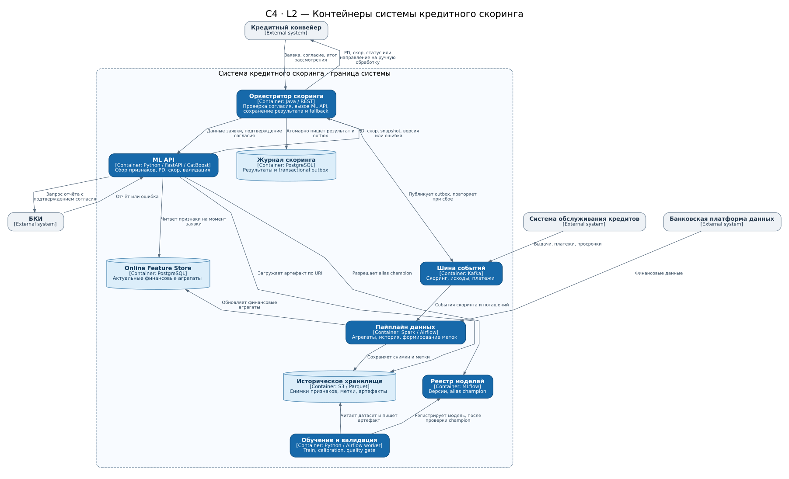
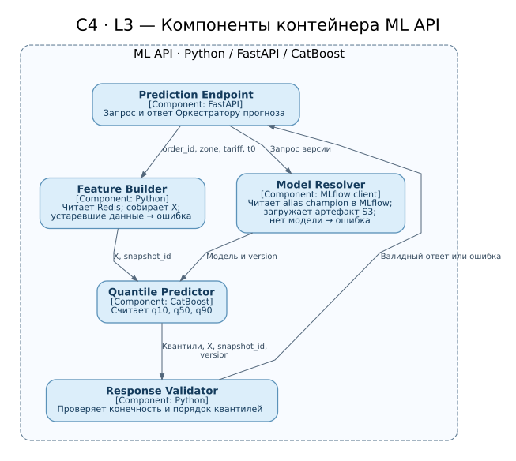

# Яндекс Go — прогноз времени поиска автомобиля

> Семинар 13. Архитектурные схемы ML-системы. Учебная реконструкция, а не документация внутренних систем Яндекса.

## 1. Компания, процесс и границы

**Компания:** Яндекс. **Продукт:** Яндекс Go.

**Процесс:** прогнозирование времени от начала поиска такси до назначения водителя после оформления заказа. Система показывает пассажиру таймер либо статус поиска без таймера и впоследствии сообщает результат поиска. Цель — сделать ожидание предсказуемым, сократить число отмен из-за неопределённости, не блокируя сам поиск при сбое ML.

В границах работы — один обычный заказ в одном выбранном тарифе, первоначальный прогноз, его проверка и показ, получение терминального исхода поиска (водитель назначен, заказ отменён или поиск завершён без назначения), запись данных для переобучения. Не рассматриваются выбор водителя, ценообразование, альтернативные тарифы, виртуальная очередь, время движения водителя до пассажира, повторные прогнозы и выполнение поездки. Система назначения водителей и платформа рыночных данных считаются внешними относительно рассматриваемой системы, хотя относятся к Яндекс Go.

## 2. Задача машинного обучения

Модель решает задачу квантильной регрессии. На вход поступают параметры заказа и снимок рыночных признаков на момент начала поиска `t0`. Модель оценивает длительность поиска в секундах, а не время прибытия машины к пассажиру.

| Признак | Источник в проекте |
|---|---|
| Зона точки подачи, тариф, локальное время, день недели | Запрос оркестратора |
| Количество свободных водителей в зоне и выбранном тарифе | Redis, агрегаты из рыночного потока |
| Число активных заказов в зоне | Redis |
| Число новых заказов и назначений за последние 5 минут | Redis |
| Отношение активных заказов к доступным водителям | Feature Builder на основе агрегатов (с защитой от деления на ноль) |

**Модель (допущение):** три модели CatBoostRegressor с функцией потерь Quantile для уровней 0,1; 0,5; 0,9. Для табличных признаков это разумный стартовый вариант: он поддерживает нелинейные зависимости и категориальные признаки. Реальный алгоритм Яндекса неизвестен.

Целевая переменная для успешного поиска: `y = assigned_at - search_started_at` (в секундах). Выход ML API: `q10`, `q50`, `q90`, `snapshot_id`, фактический вектор признаков `X`, `model_version` и статус вычисления. `q50` — точечный прогноз; `q10` и `q90` описывают оценённый интервал неопределённости. Это не гарантированный интервал, его покрытие проверяется на отложенной выборке. Прогноз оценивается условно на заказах с состоявшимся назначением; он не является вероятностью того, что назначение вообще состоится.

**Получатель результата:** Оркестратор прогноза, который принимает решение о показе таймера. Конечный получатель — пассажир в приложении Яндекс Go. Пользователь не получает внутренние признаки или версию модели.

## 3. Бизнес-процесс — BPMN


1. Пассажир оформляет заказ. Оркестратор запускает поиск в существующей системе назначения водителей и получает `order_id` и `search_started_at = t0`.
2. Оркестратор вызывает ML API. Сервис собирает признаки, определяет активную версию модели и рассчитывает квантили. Сам поиск уже идёт независимо от ответа ML.
3. Оркестратор проверяет ответ. Если прогноз пригоден, формирует таймер. Если модель недоступна, истёк тайм-аут или нарушен порог, формирует обычный статус «Ищем машину» без числового прогноза.
4. Приложение получает состояние поиска. При показе таймера учитывается уже прошедшее время: `remaining = max(0, q50 - (now - t0))`. Если таймер истёк, но водитель ещё не назначен, приложение показывает статус поиска без таймера. Если поиск уже завершён, итог имеет приоритет над промежуточным состоянием.
5. Оркестратор получает терминальный исход из системы назначения водителей: назначен водитель, отменён заказ или поиск завершён без назначения. Если итог пришёл до завершения ML, он сохраняется и используется сразу; ждать повторное событие не нужно.
6. Оркестратор записывает прогноз и исход в шину событий; приложение показывает пассажиру итог. Процесс завершается. Запись исхода не запускает обучение синхронно — оно выполняется отдельно по расписанию.

### Правило пригодности прогноза и резервный сценарий

Все численные значения ниже — проектные допущения, а не сведения о Яндексе. Оркестратор разрешает таймер только при одновременном выполнении условий:

- ML API вернул успешный ответ не позднее 300 мс после вызова (полный бюджет вызова, включая сетевое время);
- снимок рыночных агрегатов сформирован не позднее `t0` и не старше 30 секунд относительно `t0`;
- квантили конечны, `0 <= q10 <= q50 <= q90 <= 600` секунд;
- ширина интервала `q90 - q10 <= 120` секунд.

Если хотя бы одно условие не выполнено, в BPMN выбирается ветка «Нет». Отсутствие числа предпочтительнее неточного обещания. Поиск и возможность отмены заказа продолжают работать. Никакого произвольного числа при fallback пользователю не показываем. Тайм-аут и техническая ошибка приводятся к статусу ошибки вызова; в учебной BPMN они объединены с отрицательным результатом проверки в одном шлюзе XOR. Это логическая, не исполняемая BPMN.

**Обратная связь:** Оркестратор передаёт в Kafka событие расчёта при отправке состояния поиска (включая `order_id`, `t0`, `snapshot_id`, `X`, квантили, версию, причину fallback), а по завершении — событие исхода с идентификатором заказа, типом и временем исхода. Запись идемпотентна по `order_id` и типу события. Ошибочный или отсутствующий прогноз не мешает сохранить исход. При недоступности ML вектор восстанавливается из исторических снимков, если возможен корректный point-in-time join; иначе запись исключается из обучающей выборки.

## 4. C4 Level 1 — System Context


В центре одна система — система прогноза времени поиска. Пассажир взаимодействует с ней через приложение Яндекс Go. Система назначения водителей выполняет поиск и сообщает его исход, а платформа рыночных данных предоставляет информацию о спросе и предложении. Здесь намеренно не показаны сервисы, модели и хранилища.

## 5. C4 Level 2 — Containers



| Контейнер | Технология (допущение) | Ответственность |
|---|---|---|
| Оркестратор прогноза | Go, REST | Запуск поиска, вызов ML, тайм-аут, проверка интервала, fallback, отправка состояния, регистрация исхода |
| ML API | Python, FastAPI, CatBoost | Подготовка признаков и инференс модели |
| Хранилище признаков | Redis | Версионированные агрегаты по зоне и тарифу, чтение as-of `t0` |
| Шина событий | Kafka | Принимает рыночные данные, прогнозы и исходы заказов |
| Пайплайн данных | Spark Structured Streaming | Считает агрегаты, обновляет Redis, сохраняет историю и события |
| Историческое хранилище | S3-совместимое хранилище, Parquet | Снимки признаков, логи прогнозов, фактические исходы; бинарные артефакты CatBoost в отдельном префиксе |
| Обучение модели | Airflow worker, Python, CatBoost | Строит выборку, обучает кандидата, проверяет метрики, публикует артефакт |
| Реестр моделей | MLflow | Хранит метаданные версий и alias `champion`, указывающий на активную версию |

**Online-путь:** приложение → Оркестратор прогноза → ML API → Redis (признаки) / MLflow и S3 (модель) → Оркестратор прогноза → приложение.

**Offline-путь:** платформа рыночных данных / Оркестратор прогноза → Kafka → Пайплайн данных → S3 → Обучение модели → S3 (артефакт) и MLflow (версия). Redis обновляется тем же пайплайном, чтобы согласовать историческое и online-вычисление признаков.

Модель не скачивается на каждый запрос: ML API периодически проверяет alias `champion`, заранее загружает и валидирует новую версию, атомарно переключает активный кэш. При отсутствии готовой версии возвращает ошибку. Выбор версии фиксируется на запрос. Служебные БД реестра, брокера, планировщика, сетевые компоненты и детали отказоустойчивости не показаны: они не нужны для объяснения выбранного процесса.

## 6. C4 Level 3 — Components контейнера ML API



| Компонент | Назначение |
|---|---|
| Prediction Endpoint | Принимает `order_id`, зону, тариф и `t0` от Оркестратора прогноза; организует вычисление и возвращает ответ или ошибку |
| Feature Builder | Получает рыночные признаки из Redis на момент `t0`, проверяет свежесть, формирует `X` и `snapshot_id` |
| Model Resolver | Получает активную версию из MLflow, использует кэш и загружает артефакт из S3 при обновлении |
| Quantile Predictor | Рассчитывает три квантили CatBoost с выбранной версией модели |
| Response Validator | Проверяет конечность и упорядоченность квантилей, формирует валидный результат или ошибку |

Ответ возвращается через Prediction Endpoint в Оркестратор прогноза. Бизнес-порог ширины интервала и тайм-аут применяет оркестратор, а не модель. На диаграмму уровня компонентов не перенесены другие контейнеры: внешние зависимости обозначены в описаниях соответствующих модулей.

## 7. Обратная связь, обучение и оценка качества

Раз в сутки (допущение) Airflow запускает подготовку выборки по событиям с известным исходом. Снимки признаков и факты назначения соединяются по `order_id`, `snapshot_id` и времени. Используются только признаки, доступные на `t0`: это защищает от утечки будущих данных. Обучающая, валидационная и тестовая выборки разделяются хронологически, а не случайно.

Успешные назначения дают точную разметку `y`. Отмены и истечения времени поиска — цензурированные наблюдения: нельзя подставлять время отмены как время назначения. В базовом варианте они исключаются из регрессии, но сохраняются и анализируются по зонам, тарифам и прогнозам. Это создаёт смещение выборки в сторону успешных заказов; дальнейшее улучшение — модель времени до события с учётом цензурирования. Также учитываются заказы без прогнозов, если их признаки удаётся корректно восстановить.

| Метрика | Назначение |
|---|---|
| MAE по `q50` (секунды) | Основная точность прогноза на успешных назначениях |
| Pinball loss для каждого квантиля | Качество квантильной регрессии |
| Доля фактов внутри `[q10, q90]` и средняя ширина интервала | Калибровка и полезность интервала; целевое покрытие около 80% на успешных назначениях |
| Доля показанных таймеров и MAE на них | Проверка качества выборочного показа и охвата |
| p95 задержки ML API, доля fallback | Техническая доступность |
| Доля отмен до назначения | Бизнес-метрика; эффект интерфейса проверяется A/B-тестом, а не выводится из корреляции |

Базовая модель сравнения — историческая медиана длительности поиска по зоне, тарифу и часу суток (с общим медианным fallback для редких групп). Кандидат публикуется только после проверки на хронологической отложенной выборке: MAE не хуже текущей модели и baseline, покрытие интервала 75–85% и p95 задержки не выше 300 мс в нагрузочном тесте. Эти условия условные и требуют настройки по данным. Реестр хранит предыдущие версии для отката.

## 8. Соответствие BPMN и C4

| Задача BPMN | Контейнер C4 L2 / внешняя система | Результат |
|---|---|---|
| Оформить заказ | Приложение Яндекс Go → Оркестратор прогноза | Параметры заказа |
| Запустить поиск водителя | Оркестратор прогноза → Система назначения водителей | `order_id`, `t0` |
| Рассчитать прогноз | ML API (все компоненты L3) | Квантили, признаки, версия или ошибка |
| Прогноз пригоден? | Оркестратор прогноза | Выбор ветки по статусу и порогам |
| Подготовить таймер / Подготовить статус без таймера | Оркестратор прогноза | Таймер или fallback |
| Отправить состояние поиска | Оркестратор прогноза → приложение / Kafka | Состояние и событие прогноза |
| Получить таймер или статус | Приложение Яндекс Go | Отображение пассажиру |
| Получить итог поиска | Система назначения водителей → Оркестратор прогноза | Терминальный исход и время |
| Записать прогноз и исход | Оркестратор прогноза → Kafka → Пайплайн данных → S3 | История для обучения |
| Получить итог поиска (пассажир) | Приложение Яндекс Go | Назначение, отмена или завершение без назначения |

## 9. Допущения и ограничения реконструкции

1. Прогноз и его проверка выделены в самостоятельную систему с отдельным оркестратором и ML API. Реальное распределение ответственности неизвестно.
2. Система назначения водителей и платформа рыночных данных — абстрактные внешние интерфейсы. Их реальные названия, API, регламент обработки отмен и формат событий неизвестны.
3. Процесс ограничен первоначальным прогнозом одного заказа; порядок вызовов, правила при гонке событий и истечении таймера — проектные решения.
4. Выбраны CatBoost, квантильная постановка, перечень признаков и способ формирования метки. Архитектура реальной модели и её обучающие данные не раскрыты в использованных источниках.
5. Пороги 300 мс, 30 секунд, 600 секунд и 120 секунд, а также резервный статус без таймера — предложенные правила, а не внутренний регламент Яндекса.
6. Go, FastAPI, Kafka, Spark, Redis, S3, Airflow и MLflow — возможный стек реализации. Реальное применение этих технологий именно в данной функциональности не подтверждено.
7. Периодичность обучения, метрики допуска, механизм хранения кэша, идемпотентность, обратная связь и схема версионирования — проектные решения.
8. Работа не содержит реализации ML-модели и результатов экспериментов; метрики предложены для проверки гипотезы, а не измерены.

## 10. Источники

- [CNews, 23.04.2026 — ИИ в Яндекс Go покажет время поиска машины](https://www.cnews.ru/news/line/2026-04-23_ii_v_yandeks_go_predugadaet). Подтверждает наличие прогноза назначения после заказа и использование информации о спросе, районе и доступных водителях (со ссылкой на представителей компании).
- [Блог городских сервисов Яндекса, 22.01.2026 — Как работает добавление тарифов в Такси при долгом поиске](https://dev.go.yandex/blog/additional-rates-for-long-searches-2026-01-22). Объясняет проблему долгого назначения и связь ожидания с отменами. Добавление тарифов не входит в границы работы.
- [C4 model](https://c4model.com/) — описание уровней архитектурной модели.
- [Camunda: BPMN 2.0 Examples](https://camunda.com/bpmn/examples/) — справка по BPMN.

**Что разработано для этой работы:** все четыре схемы, граница системы, последовательность действий, связи контейнеров и компонентов, ML-постановка, пороговое правило, fallback и цикл обучения. Публичные материалы использованы для подтверждения бизнес-сценария, а не как источник готовой архитектуры. Схемы не претендуют на точное описание системы Яндекса.

## 11. Файлы, нотации и открытие

| Схема | Редактируемый исходник | Изображение |
|---|---|---|
| BPMN | [BPMN 2.0 XML](diagrams/bpmn.bpmn), [Mermaid-представление](diagrams/bpmn.mmd) | [SVG](diagrams/bpmn.svg), [PNG](diagrams/bpmn.png) |
| C4 Context | [Mermaid](diagrams/c4-context.mmd) | [SVG](diagrams/c4-context.svg), [PNG](diagrams/c4-context.png) |
| C4 Containers | [Mermaid](diagrams/c4-containers.mmd) | [SVG](diagrams/c4-containers.svg), [PNG](diagrams/c4-containers.png) |
| C4 Components | [Mermaid](diagrams/c4-components.mmd) | [SVG](diagrams/c4-components.svg), [PNG](diagrams/c4-components.png) |

Файл `.bpmn` — BPMN 2.0 XML с координатами DI: предназначен для [Camunda Modeler](https://camunda.com/download/modeler/). `.mmd` можно открыть в [Mermaid Live Editor](https://mermaid.live/) или в редакторе с поддержкой Mermaid. Схемы C4 используют Mermaid flowchart с явными стереотипами C4 и границами, а не отдельный C4-синтаксис. `bpmn.mmd` — текстовая копия логики, основная нотационная схема — `.bpmn` и её изображение. SVG и PNG открываются браузером; SVG удобно увеличивать. Иллюстрации C4 сформированы из `.mmd` через локальное преобразование в Graphviz, BPMN — из геометрии BPMN XML. Нативный рендер Mermaid и импорт в Camunda в среде подготовки не проверялись.

**Легенда BPMN:** тонкий круг — старт, толстый круг — конец, прямоугольник со скруглением — задача, ромб с X — исключающий шлюз, сплошная стрелка — последовательность, пунктир — ассоциация с аннотацией. Горизонтальные области — дорожки ролей. Значок человека — пользовательская задача, шестерёнка — сервисная, конверт — получение сообщения. В Mermaid-копии круги и ромбы передают ту же логику, но не заменяют BPMN XML.

**Легенда C4:** тёмно-синий — человек; синий — проектируемая система или контейнер; светло-синий — хранилище / компонент; серый — внешняя система. Цилиндр — хранилище. Пунктирная граница — область детализации (система или ML API). Стрелка показывает направление взаимодействия; подпись поясняет передаваемые данные либо операцию. C4 не задаёт универсальную графическую нотацию, поэтому типы элементов явно подписаны.

### Воспроизведение изображений

Готовые картинки уже включены в репозиторий. Для локальной регенерации C4 нужен Python 3 и Graphviz (`dot` в PATH); для BPMN — Python 3 с `lxml` и `cairosvg`. Скрипт C4 поддерживает только использованное в проекте подмножество Mermaid, не является универсальным рендерером. Скрипт BPMN создаёт XML и изображение из одного описания процесса и координат; после ручного редактирования BPMN XML картинку удобнее экспортировать в Modeler.

```bash
python tools/render_c4.py
python -m pip install lxml cairosvg
python tools/build_bpmn.py
```
