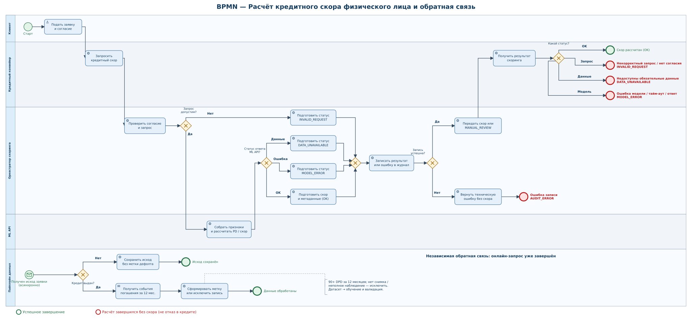
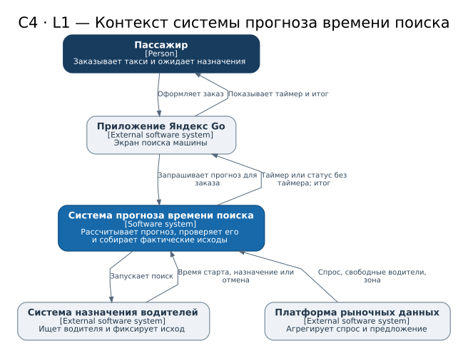

# Архитектура ML-системы расчёта кредитного скора физического лица

**Компания:** Сбербанк. **Продукт:** необеспеченный потребительский кредит.  
**Работа:** семинар 13 — проектирование ML-системы (BPMN и C4).

> Учебная реконструкция, а не документация внутренней системы Сбера. Все конкретные технологии, формулы, пороги и регламенты ниже — проектные допущения.

## 1. Бизнес-процесс и его границы

Клиент подаёт заявку на потребительский кредит. Кредитный конвейер запрашивает у системы скоринга оценку кредитного риска. Система проверяет запрос и согласие на получение кредитной истории, собирает признаки, рассчитывает PD и преобразует её в кредитный скор. Конвейер получает результат либо статус `MANUAL_REVIEW` с причиной, если корректный скор получить невозможно, либо техническую ошибку `AUDIT_ERROR`, если журнал недоступен.

**Получатель результата модели:** кредитный конвейер. Клиент не получает внутренний PD непосредственно от сервиса скоринга. Скор является одним из входов для дальнейшего рассмотрения заявки, а не решением о выдаче кредита.

В границах работы: получение признаков, онлайн-инференс, контроль корректности, запись результата, передача в конвейер, получение фактических исходов и подготовка данных для следующего обучения. За рамками: идентификация клиента, антифрод, андеррайтинг, правила одобрения, расчёт лимита и ставки, LGD, EAD, заключение договора и обслуживание кредита. Эти системы представлены только через необходимые интерфейсы.

## 2. ML-задача

Задача — бинарная классификация с оценкой вероятности дефолта (PD) по кредиту в первые 12 месяцев после выдачи. Объект — заявка физлица на конкретный продукт, а не универсальный рейтинг человека. В учебном проекте дефолт определяется как достижение 90 и более дней просрочки (90+ DPD) по выданному кредиту в пределах горизонта наблюдения. Это не утверждение о регуляторном или внутреннем определении дефолта Сбера.

**Модель:** CatBoostClassifier, затем калибровка вероятности на отдельной временной выборке. Бейзлайн для сравнения — логистическая регрессия.

### Входы

| Источник | Примеры полей |
|---|---|
| Кредитный конвейер | Параметры заявки, запрошенная сумма и срок, ID заявки, время t0, подтверждение согласия |
| Банковская платформа данных → Online Feature Store | Подтверждённые финансовые агрегаты, например доход и действующие обязательства |
| БКИ | Кредитная история, действующие обязательства, сведения о просрочках либо подтверждённое отсутствие истории |

Приведённые признаки иллюстративны. Перед промышленным применением нужны правовая, методологическая и независимая модельная валидация; персональные идентификаторы используются для поиска данных, но не как признаки модели. Чувствительные характеристики и их явные прокси не включаются. Сырые кредитные отчёты не публикуются в Kafka.

### Выходы

- `application_id`, `scoring_id`, `as_of_ts`, `snapshot_id`;
- `pd_12m` — калиброванная вероятность в диапазоне [0, 1];
- `score` — целое число от 0 до 1000, больше означает меньший прогнозируемый риск;
- `model_version`, `feature_schema_version`, `status`, `reason_code` (при ошибке).

Учебное преобразование: `score = round(1000 * (1 - pd_12m))`. Это простая монотонная шкала для демонстрации архитектуры, не промышленная scorecard и не скоринг БКИ. Она не задаёт порог одобрения кредита.

При `MANUAL_REVIEW` PD и score отсутствуют; нулевой скор вместо ошибки не подставляется. Передача статуса означает необходимость дальнейшей проверки в конвейере, не отказ в кредитовании.

## 3. BPMN — бизнес-процесс



1. Клиент оформляет заявку и предоставляет согласие. Конвейер запрашивает скор.
2. Оркестратор проверяет схему запроса и наличие действительного согласия. При ошибке формирует `INVALID_REQUEST` без обращения в БКИ.
3. ML API собирает признаки, разрешает версию модели, выполняет инференс, калибровку и преобразование PD в скор. При отсутствии обязательных данных возвращает `DATA_UNAVAILABLE`, при технической ошибке модели или некорректном ответе — `MODEL_ERROR`.
4. Оркестратор формирует результат или статус ошибки без числовой оценки, затем пытается записать его в журнал. Если запись не удалась, возвращает техническую ошибку `AUDIT_ERROR` без скора. Если запись удалась, передаёт итог конвейеру.
5. Конвейер получает `OK` или `MANUAL_REVIEW` с кодом причины. Онлайн-процесс завершается одним из пяти конечных событий. Дальнейшее решение о кредите принимается вне системы скоринга.
6. Независимый асинхронный поток запускается при получении исхода заявки. Если кредит не выдан, исход сохраняется без метки дефолта. Для выданного кредита пайплайн получает события обслуживания, формирует метку после созревания горизонта либо исключает неполную запись.

Зелёный конечный круг — успешное завершение; красный — расчёт завершился без корректного скора. Красные круги — обычные BPMN End Events с цветовым выделением, а не Error End Events с выбрасыванием BPMN-ошибки. Отказ в кредитовании не моделируется. Обратная связь независима от успешности онлайн-запроса и связывается через application_id, scoring_id и loan_id при наличии этих идентификаторов.

### Пороги и запасной маршрут (допущения)

| Условие | Действие |
|---|---|
| Нет действительного согласия либо запрос не соответствует контракту | `MANUAL_REVIEW`, `INVALID_REQUEST`; не обращаться в БКИ |
| Обязательные признаки отсутствуют; финансовый снимок старше 24 часов; отчёт БКИ не получен в рамках запроса | `MANUAL_REVIEW`, `DATA_UNAVAILABLE` |
| БКИ подтвердило отсутствие кредитной истории | Допустимая отдельная категория, не техническая ошибка |
| ML API не ответил за 3 секунды, модель не загружена или несовместима со схемой признаков | `MANUAL_REVIEW`, `MODEL_ERROR` |
| PD не конечна, выходит за [0,1], скор вне [0,1000], не указана версия или нарушена согласованность PD и скора | `MANUAL_REVIEW`, `MODEL_ERROR` |
| Журнал недоступен, запись результата или ошибки не удалась | `AUDIT_ERROR`, техническая ошибка без PD и скора; повтор или ручная обработка в конвейере |
| Ответ валиден и запись успешна | `OK`, вернуть скор независимо от величины PD |

Тайм-аут 3 секунды — условный бюджет ML API, включая получение БКИ; 24 часа — условный SLA внутренних агрегатов. Пороги проверяют техническую пригодность результата, а не кредитоспособность. Если журнал недоступен, возвращается техническая ошибка без числового скора; конвейер повторяет запрос идемпотентно либо направляет на ручную обработку.

## 4. C4 System Context (L1)



В центре — система кредитного скоринга. Снаружи: клиент, кредитный конвейер, банковская платформа данных, БКИ и система обслуживания кредитов. Клиент взаимодействует с конвейером; скоринг не выдаёт кредит самостоятельно.

## 5. C4 Containers (L2)


| Контейнер | Технология | Назначение |
|---|---|---|
| Оркестратор скоринга | Java, REST | Контракт запроса, проверка согласия, вызов ML API, fallback, аудит и публикация событий |
| ML API | Python, FastAPI, CatBoost | Сбор признаков, выбор модели, расчёт PD и скора |
| Online Feature Store | PostgreSQL | Версионированные финансовые агрегаты и время их актуальности |
| Журнал скоринга | PostgreSQL | Результат, снимок признаков или защищённая ссылка, статус, transactional outbox |
| Шина событий | Kafka | События скоринга, итог рассмотрения, выдача, платежи и просрочки |
| Пайплайн данных | Spark, Airflow | Подготовка агрегатов, перенос событий в историю, формирование меток |
| Историческое хранилище | S3-совместимое хранилище, Parquet | Снимки, метки, версионированные датасеты и артефакты |
| Обучение и валидация | Python, Airflow worker | Обучение, калибровка, сравнение с бейзлайном и проверка новой версии |
| Реестр моделей | MLflow | Версии, URI артефактов и alias `champion` |

Онлайн-путь: конвейер → оркестратор → ML API → Feature Store / БКИ / реестр и хранилище моделей → оркестратор → журнал → конвейер. ML API кэширует утверждённый артефакт, фиксируя версию на время запроса; модель не обучается в онлайн-контуре.

Офлайн-путь: банковская платформа → пайплайн → Feature Store; оркестратор и система обслуживания → Kafka → пайплайн → историческое хранилище → обучение → реестр. После независимой проверки новая версия получает alias `champion`, а артефакт размещается в хранилище. Outbox обеспечивает повторную доставку; потребители дедуплицируют события по event_id. Итог заявки поступает в оркестратор асинхронно и сохраняется тем же путём.

## 6. C4 Components (L3) — ML API


| Компонент | Ответственность |
|---|---|
| Scoring Endpoint | Принимает заявку, вызывает компоненты и возвращает ответ оркестратору |
| Feature Builder | Читает признаки из Online Feature Store и БКИ, проверяет согласие, актуальность и схему, фиксирует снимок X |
| Model Resolver | Получает alias champion из MLflow, проверяет совместимость версии, загружает модель и калибратор по URI |
| PD Predictor | Вычисляет вероятность дефолта и калибрует её |
| Score Mapper | Преобразует PD в скор |
| Response Validator | Проверяет ответ и возвращает результат либо ошибку через Scoring Endpoint |

Внутри схемы только модули ML API. Другие контейнеры упомянуты как зависимости в подписях компонентов, но не изображены повторно. Ошибки Feature Builder и Model Resolver прерывают инференс и возвращаются через Endpoint; стрелки с `или ошибка` обозначают этот контракт, а не вычисление на невалидном векторе.

## 7. Обратная связь, обучение и мониторинг

Снимок X фиксируется на момент t0 (заявка), используется только доступная к этому моменту информация. События выдачи связывают application_id с loan_id. Целевая переменная: y=1, если наступило 90+ DPD в течение 12 месяцев после выдачи; y=0, если горизонт полностью наблюдался и события дефолта не было. Неполное наблюдение — не нулевой класс. Для простоты набор формируется после полного горизонта наблюдения; исключение для досрочного погашения не проектируется. Отказы и невыданные кредиты не размечаются как дефолт либо отсутствие дефолта. Ошибки скоринга без сохранённого снимка также не попадают в выборку.

Обучение на выданных кредитах подвержено selection bias: качество на отклонённых заявках из этих данных неизвестно. Оценка метрик относится к наблюдаемому портфелю; перенос на всю популяцию заявок не доказан. Валидация — по времени (train, calibration, out-of-time test), с контролем пересечения клиентов и утечек. Калибровка и подбор гиперпараметров не используют финальный test.

Метрики: ROC-AUC / Gini (ранжирование); Brier score и calibration curve (качество PD); PSI и дрейф признаков (стабильность); p95 latency, доля технических ошибок и fallback (сервис). Сравнение новой версии с текущей и логистической регрессией, анализ устойчивости и справедливости при наличии законных данных для аудита. Продвижение в champion только после независимой проверки и согласования риск-методологом; автоматическая публикация по одной метрике не допускается. Численные результаты экспериментов не заявляются, поскольку модели в рамках задания не обучались.

## 8. Соответствие BPMN и C4

| Задача BPMN | Контейнер C4 / внешняя сторона |
|---|---|
| Подать заявку и согласие | Клиент → Кредитный конвейер (L1) |
| Запросить кредитный скор | Кредитный конвейер → Оркестратор скоринга |
| Проверить согласие и запрос | Оркестратор скоринга |
| Собрать признаки и рассчитать PD / скор | ML API (все компоненты L3), Feature Store, БКИ, MLflow, S3 |
| Статус ответа ML API? / Подготовить статус или скор | Оркестратор скоринга, контракт ответа ML API |
| Записать результат или ошибку в журнал / Запись успешна? | Оркестратор скоринга → Журнал скоринга |
| Передать скор или MANUAL_REVIEW / Вернуть техническую ошибку без скора | Оркестратор скоринга → Кредитный конвейер |
| Получить результат скоринга / Какой статус? | Кредитный конвейер |
| Получить исход заявки / Записать исход без метки дефолта | Кредитный конвейер → Оркестратор → Kafka → Пайплайн данных |
| Получить события погашения за 12 мес. | Система обслуживания кредитов → Kafka → Пайплайн данных |
| Сформировать метку и сохранить датасет | Пайплайн данных → Историческое хранилище; последующее обучение и валидация |

## 9. Допущения и источники

**Подтверждено публично:** Сбер описывает скоринг как оценку вероятности возврата кредита и использование индивидуальной оценки при рассмотрении потребительской заявки. Банк России поясняет необходимость согласия для доступа к основной части кредитной истории. Конкретный внутренний маршрут данных, модель и регламенты Сбера из этих источников не следуют.

**Самостоятельно спроектировано:**

1. Синхронный сервис application scoring и его граница с кредитным конвейером; конкретные сервисы и протоколы.
2. CatBoost, калибровка, горизонт 12 месяцев, правило 90+ DPD и шкала 0–1000.
3. Набор признаков и Feature Store, проверка свежести, условный бюджет ответа 3 секунды.
4. Ручной маршрут без скорингового значения при ошибке; конкретный регламент банка неизвестен.
5. PostgreSQL, Kafka, Spark, Airflow, S3, MLflow, логирование и outbox; реальный стек банка неизвестен.
6. Сбор меток, схема обучения, механизм champion и контроль качества.
7. Предполагаются защищённый контур, шифрование, разграничение доступа, аудит и ограниченные сроки хранения. Фактические политики банка не известны. Реальная реализация требует проверки правовых оснований и требований информационной безопасности.

**Источники** (обращение: 25.11.2026):

- [Сбер — что такое скоринг в банке](https://www.sberbank.ru/ru/person/blog/chto-takoe-skoring-v-banke-prostymi-slovami).
- [Сбер — кредитный калькулятор и индивидуальная оценка заёмщика](https://www.sberbank.ru/ru/person/credits/money/kreditnyj_kalkulyator).
- [Банк России — доступ кредитной организации к кредитной истории](https://www.cbr.ru/Reception/TopicalMessage/Page/3154).
- [C4 model](https://c4model.com/) — нотация; [Camunda BPMN examples](https://camunda.com/bpmn/examples/) — нотация BPMN.

Ни одна опубликованная архитектурная схема банка не копировалась. Источники подтверждают бизнес-контекст и используются для нотаций, а не для восстановления реальной инфраструктуры.

## 10. Файлы и просмотр

| Схема | Исходник | Изображение |
|---|---|---|
| BPMN | `bpmn.bpmn`, `bpmn.mmd` | `bpmn.svg` |
| C4 Context | `c4-context.mmd` | `c4-context.svg` |
| C4 Containers | `c4-containers.mmd` | `c4-containers.svg` |
| C4 Components | `c4-components.mmd` | `c4-components.svg` |

Все схемы расположены в директории `diagrams/`.

- `.bpmn` — Camunda Modeler.
- `.mmd` — Mermaid Live Editor.
- `.svg` — браузер или GitHub.## 10. Файлы и просмотр

| Схема | Исходный файл | Изображения |
|---|---|---|
| BPMN | [bpmn.bpmn](diagrams/bpmn.bpmn), [bpmn.mmd](diagrams/bpmn.mmd) | [SVG](diagrams/bpmn.svg), [PNG](diagrams/bpmn.png) |
| C4 Context | [c4-context.mmd](diagrams/c4-context.mmd) | [SVG](diagrams/c4-context.svg), [PNG](diagrams/c4-context.png) |
| C4 Containers | [c4-containers.mmd](diagrams/c4-containers.mmd) | [SVG](diagrams/c4-containers.svg), [PNG](diagrams/c4-containers.png) |
| C4 Components | [c4-components.mmd](diagrams/c4-components.mmd) | [SVG](diagrams/c4-components.svg), [PNG](diagrams/c4-components.png) |

- SVG/PNG открываются в браузере и отображаются в README GitHub.
- `.bpmn` — BPMN 2.0 XML с координатами; открыть в Camunda Modeler. `.mmd` — текстовое представление процесса, не замена полноценной BPMN-нотации.
- C4 `.mmd` — Mermaid Live Editor (https://mermaid.live/) или редактор с Mermaid.
- Легенда: тёмно-синий — человек/основная система, синий — система/сервис, светло-синий цилиндр — хранилище, светло-синий прямоугольник L3 — компонент, серый — внешняя система; пунктирная рамка — граница системы/контейнера. Типы явно подписаны на блоках. BPMN: круг — событие, ромб с X — XOR, прямоугольник — задача, дорожка — ответственный; красный конечный круг — завершение без скора, зелёный — успешное завершение.

Изображения построены локально из текстового описания: C4 — Graphviz по Mermaid-исходникам; BPMN — по той же геометрии, что используется в BPMN XML. Скрипты находятся в `tools/`. Нативный рендерер Mermaid и импорт в Camunda Modeler не проверялись в текущей среде; расположение элементов в нативном рендерере может отличаться. Скрипты используют Python 3, Graphviz (`dot`), lxml и CairoSVG.

```bash
python tools/build_bpmn.py
python tools/render_c4.py
```
